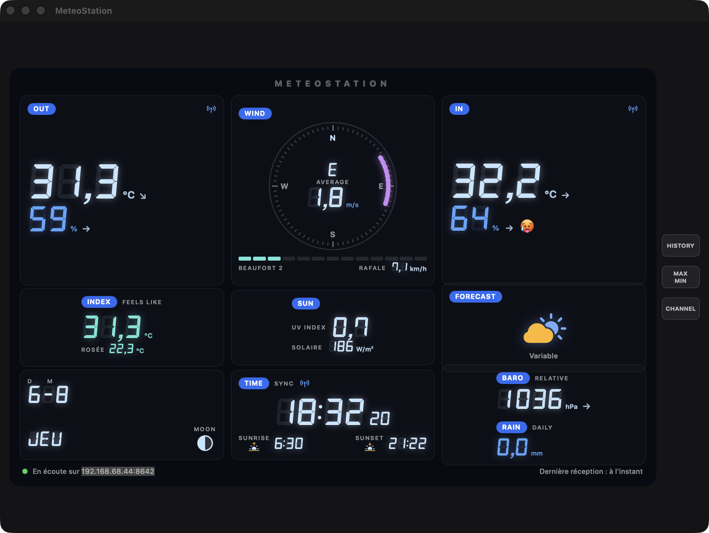

# MeteoStation

[](https://github.com/vincentlauriat/MeteoStation/releases/latest)


A macOS app that mirrors a **Bresser Weather Center 7-in-1** console — all station data, live, on your Mac, **fully local**. No cloud, no account, no polling: the station pushes its readings straight to the app every ~5 seconds.



## How it works

The Bresser console (WSX3001 generation) can upload readings to a custom weather server in the Weather Underground format. MeteoStation embeds a small HTTP server (Network.framework) that receives those uploads on your LAN — the app *is* the weather server.

```
Bresser 7-in-1 sensors ──RF──▶ Console ──WiFi (WU format, ~5 s)──▶ MeteoStation (your Mac)
```

## Features

| Feature | Status |
|---|---|
| Local HTTP listener (WU format, configurable port, real-time ~5 s updates) | ✅ |
| Outdoor temp/humidity, dew point, feels-like | ✅ |
| Wind compass (direction, speed, gust, Beaufort scale) | ✅ |
| Rain (rate, daily) | ✅ |
| UV index & solar radiation | ✅ |
| Pressure + 24 h graph + trend forecast | ✅ |
| Indoor temp/humidity, comfort smiley | ✅ |
| Moon phase, clock (with seconds), date, sunrise/sunset (local NOAA computation) | ✅ |
| Console-style UI (true 3×3 layout, DSEG 7-segment font, pills, trend arrows) | ✅ |
| Bezel buttons: HISTORY, MAX/MIN (today stats), CHANNEL cycling | ✅ |
| Metric/imperial units | ✅ |
| Auto-updates (Sparkle, signed & notarized) | ✅ |
| 7-day local history (JSON, Application Support) | ✅ |

## Install

Download the latest DMG from the [Releases page](https://github.com/vincentlauriat/MeteoStation/releases/latest), open it and drag **MeteoStation** to Applications. The app is signed with a Developer ID and notarized by Apple. Updates are delivered in-app via Sparkle.

## Configure your station

Full step-by-step guide (with screenshots of the console web UI): **[docs/CONFIGURATION.md](docs/CONFIGURATION.md)**.

Short version — the console is configured through its built-in web interface (AP mode):

1. Launch MeteoStation. The status bar shows the address to use, e.g. `192.168.68.44:8642`.
2. On the console, hold **[SENSOR/WI-FI]** for 6 s → it creates a `PWS-XXXXXX` WiFi network.
3. Connect to it and open `http://192.168.1.1`.
4. In the weather-server section, use the **free-URL service slot** (the one pre-filled with `ws.awekas.at`): set the URL to your Mac's `IP:port`, any station ID/key.
5. Apply — the console reconnects to your home WiFi and starts pushing. Readings appear within seconds.

> **Tip:** give your Mac a DHCP reservation on your router. If the Mac's IP changes, the console will silently push into the void.

> **Note:** the mobile app *WSLink* does not work with the WSX3001 console generation — use the AP-mode web UI above. Extra sensor channels (CH1…, soil…) are not transmitted by the console on this upload service; the app supports them generically if a firmware exposes them.

## Build from source

```bash
xcodegen generate
xcodebuild -scheme MeteoStation -configuration Debug build
```

Requires Xcode 16+ (macOS 14 deployment target) and [xcodegen](https://github.com/yonaskolb/XcodeGen). Sparkle is fetched via SPM on first build.

## Project layout

```
MeteoStation/
├── project.yml              # xcodegen definition (SPM: Sparkle)
├── Scripts/release.sh       # signed + notarized DMG build, Sparkle appcast
├── appcast.xml              # Sparkle update feed
├── docs/                    # configuration guide, screenshots
└── MeteoStation/
    ├── MeteoStationApp.swift
    ├── Models/              # WeatherReading (WU parsing, unit conversion)
    ├── Services/            # StationListener (HTTP server), HistoryStore
    ├── ViewModels/          # StationViewModel
    ├── Views/               # ConsoleView + console components
    └── Helpers/             # network info, moon phase, formatters
```

## Roadmap

- [x] v1.0.0 — local listener + console UI + Sparkle auto-update
- [ ] Menu bar extra
- [ ] Threshold notifications
- [ ] CSV export

## Credits

Seven-segment rendering uses the [DSEG fonts](https://github.com/keshikan/DSEG) by Keshikan, bundled under the SIL Open Font License (see `MeteoStation/Fonts/DSEG-LICENSE.txt`). Auto-updates powered by [Sparkle](https://sparkle-project.org).

## License

[MIT](LICENSE) — © 2026 Vincent Lauriat.
